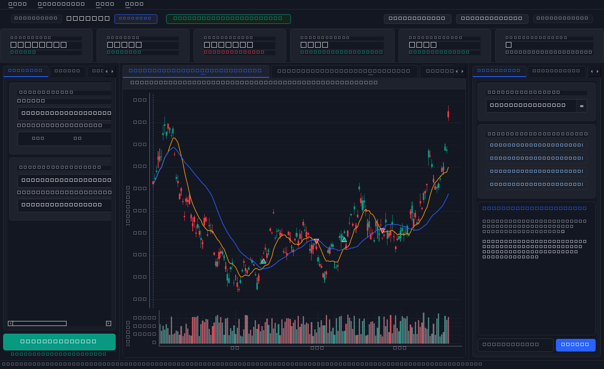
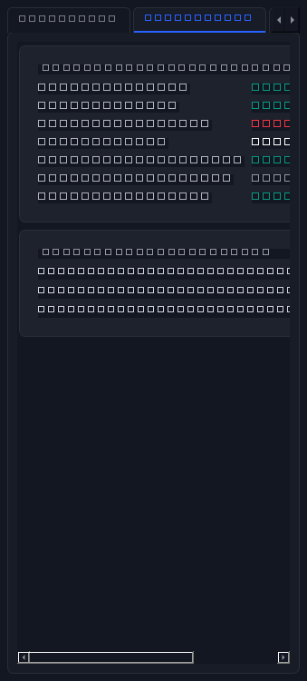
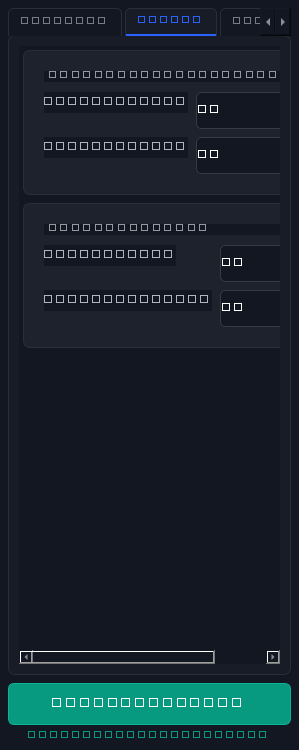
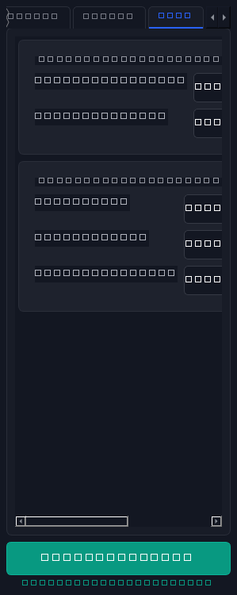

# QUANTIX // AI Stocks Backtesting & Quantitative Research Terminal



A high-performance desktop workstation for algorithmic stock backtesting and AI-driven quantitative research, built natively with **PySide6 (Qt 6 for Python)** and **pyqtgraph**.

---

## 🌟 Key Features

* **High-Frequency 60 FPS Visuals**: Hardware-accelerated candlestick charting powered by `pyqtgraph` with pixel-aligned wicks, volume bars, moving average overlays (SMA 10, SMA 30), and buy/sell execution markers.
* **Cursor Crosshair HUD**: Real-time cursor tracking displaying tabular Open, High, Low, Close, Volume, and indicator values without layout jitter.
* **Tabbed Settings Distribution**:
  * **`[Strategy]` Tab**: Target asset picker, segmented timeframe selector (`15m`, `1H`, `4H`, `1D`), model selection, and benchmark index.
  * **`[Params]` Tab**: Fast/slow moving average windows, RSI filters, and minimum ADX trend strength.
  * **`[Risk]` Tab**: Initial capital sizing, position allocation %, stop loss %, take profit %, and broker fee/slippage friction.
  * **`[Optimize]` Tab**: Monte Carlo simulations and objective optimization metrics.
* **AI Research Copilot**: Integrated quantitative assistant with rapid diagnostic chips (*Analyze Drawdown Risk*, *Parameter Tuning*, *Expectancy Diagnosis*), model inference selection (`Claude 3.5`, `Gemini 1.5`, `DeepSeek-R1`), and streaming chat.
* **Portfolio Analytics & Drawdowns**: Interactive cumulative equity growth curve with underwater drawdown zones and peak high-water mark references.
* **Institutional Risk Measures**: Daily VaR 95%, Sortino Ratio, Calmar Ratio, Beta to benchmark, and Market Regime exposure.
* **Desktop Workstation Ergonomics**: Native menu bar (`File`, `Strategies`, `View`, `Tools`, `Help`), hotkeys (`F5` to run backtest, `Ctrl+B` / `Ctrl+J` to toggle sidebars), and fluidly resizable splitters.

---

## 📸 Screenshots

| Price Action & Signals | Institutional Risk Stats |
|:---:|:---:|
|  |  |

| Strategy Parameters | Risk & Capital Controls |
|:---:|:---:|
|  |  |

---

## 🚀 Quick Start

### 1. Clone the Repository
```bash
git clone https://github.com/Mohmed-Husain/Backtesting-Deskapp.git
cd Backtesting-Deskapp
```

### 2. Install Dependencies
```bash
pip install -r requirements.txt
```

### 3. Launch the Terminal
```bash
python main.py
```

---

## 📁 Project Architecture

```
Backtesting-Deskapp/
├── main.py                     # Desktop application entry point
├── requirements.txt            # Python dependencies
├── README.md                   # Documentation & showcase
├── .gitignore                  # Git exclusions
│
├── assets/                     # Application screenshots & UI previews
│   ├── desktop_tabbed_main.png
│   ├── desktop_panel_params.png
│   ├── desktop_panel_risk.png
│   └── desktop_panel_ai_stats.png
│
└── app/
    ├── styles.py               # Modern financial dark QSS theme (TradingView palette)
    │
    ├── core/
    │   └── mock_data.py        # Realistic OHLCV data generator & backtest simulation engine
    │
    └── ui/
        ├── main_window.py      # Master QMainWindow with menus, header, and splitters
        └── components/
            ├── chart_widget.py       # High-speed Candlestick + Volume Chart with crosshairs
            ├── equity_chart.py       # Cumulative Equity Curve & Underwater Drawdown Chart
            ├── metrics_cards.py      # KPI cards (Sharpe, Net PnL, Max DD, Win Rate)
            ├── trades_table.py       # Executed Trades Ledger with colored badges
            ├── strategy_panel.py     # Tabbed Strategy, Parameters & Risk Configuration
            └── ai_panel.py           # Tabbed AI Research Copilot & Alpha Analytics
```

---

## 🛠️ Tech Stack

* **UI Framework**: [PySide6 (Qt 6)](https://wiki.qt.io/Qt_for_Python)
* **Charting Engine**: [pyqtgraph](https://www.pyqtgraph.org/)
* **Numerical & Data Processing**: [NumPy](https://numpy.org/) & [Pandas](https://pandas.pydata.org/)
* **Design Standards**: Derived from [`jakubkrehel/skills`](https://github.com/jakubkrehel/skills)
